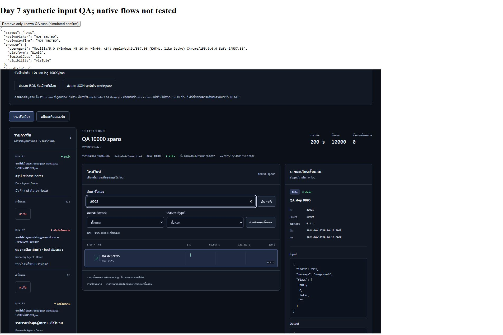

# ผลงาน Day 7 — ปิดรุ่นแรก — 14 ตุลาคม 2026

**พร้อมใช้ภายในขอบเขตที่ตรวจ** ไม่พบข้อผิดพลาดที่ทำให้ข้อมูลหายหรือผิดจากกรณีที่ตรวจ ไม่เพิ่มฟีเจอร์ ไม่แก้ production code เพียงเพื่อให้มี diff และไม่เปลี่ยน schema/dependencies ไม่มี AI API/backend/login/live logs/deployment

ทำงานภายในกรอบไม่เกิน 4 ชั่วโมง หยุดหลังการตรวจที่ทำได้ คู่มือ และบันทึกครบ ไม่เริ่มงานต่อยอด ช่องว่าง native flows คงสถานะยังไม่ได้ตรวจตามหลักฐาน ไม่ได้อ้างว่าผู้ใช้ทดลองผ่านแล้ว

## ก่อนตรวจและการแยกข้อมูล

อ่านคำแนะนำโปรเจกต์/ponytail/coding-workflow/computer-use, README, DAY6.md และ docs/day6-checks.json ตรวจ code/tests ที่เกี่ยวข้องและ package scripts เดิม ไม่มี AGENTS.md ที่เกี่ยวข้องหรือ Git repository เก็บ baseline ของ src/tests/schema/examples/package.json/lockfile เพื่อเทียบหลังจบ

ใช้ production dist เดิมที่สร้างจากโค้ดเดียวกับ final build ไม่มี QA controls ใน bundle ตัวจริง เสิร์ฟผ่าน HTTP server ของ Node ที่ผูก **127.0.0.1** เท่านั้น: :5227 สำหรับดาวน์โหลดจริง และ :5228 สำหรับ round-trip/performance ทั้งสอง origin เริ่มว่าง แยกจากแท็บผู้ใช้ :5173 ไม่อ่าน/เขียน IndexedDB ของ origin ผู้ใช้ ไม่เปลี่ยน browser settings และไม่ลบ downloads/ไฟล์สำรองของผู้ใช้

QA page ชั่วคราวใช้ iframe production app และ helpers ที่ compile จาก src เดิมด้วย TypeScript ที่ติดตั้งอยู่ ใช้ File/DataTransfer กับ bytes ไฟล์จริง/fixtures และ dispatch DOM events **ไม่ใช่ OS picker หรือการพิมพ์จริง** ยกเลิก/ตอบรับ confirm ด้วย fixture ไม่นับเป็น native flow วันก่อน; วันนี้ใช้ confirm จำลองเฉพาะ cleanup รันสมมติของ QA ไม่ใช้เป็นผลทดสอบ native confirm

## ตารางฟีเจอร์และสถานะ

| ฟีเจอร์/เส้นทาง | สถานะ | หลักฐานและขอบเขต |
| --- | --- | --- |
| นำเข้า JSON v1 / syntax/schema/ID/parent/เวลา | ผ่าน | unit tests จริงบน Node; UI ด้วย File/DataTransfer และข้อมูลสมมติใน Day 6/7 ไม่ใช่ picker |
| OS picker เลือกไฟล์ / Cancel / เลือก path เดิมหลังแก้ | ยังไม่ได้ตรวจ | ทดลอง chooser API อีกครั้ง ถูกสิทธิ์ส่วนขยาย Allow access to file URLs ปฏิเสธ ไม่เปลี่ยน settings; ไม่ใช้ผล File fixture แทน |
| ไทม์ไลน์/รายละเอียด/งานซ้อน | ผ่าน | ตัวอย่างเดิม Day 6; browser production วันที่ 7 แสดง 1,000/10,000 แถวและข้อมูลขั้นตอนที่เลือก |
| ค้นไทย/input/output/error + status/type AND | ผ่าน | unit tests และ browser input จำลอง Day 6; search/selection/clear 1,000/10,000 spans อย่างละ 5 รอบวันที่ 7 |
| กรอง parent / hidden selection | ผ่าน | Day 6 UI fixture + regression เดิม ยืนยันแกนเวลา/depth/details ไม่เปลี่ยน |
| เปรียบเทียบ A/B / swap / เปลี่ยนฝั่งเดียว / กลับเดี่ยว | ผ่าน | regression เดิม + Day 6 UI และวันที่ 7 เปรียบเทียบ 1,000/10,000 spans เลือกเอง option 1001/10001, delta +9000 และกลับเดี่ยวได้ |
| ระยะเวลาของขั้นตอนยังไม่จบ | ผ่าน | regression ทั้งจบ/ไม่จบ/เลือกไม่ครบ/0 duration; browser Day 6 แสดง unavailable ตามกติกา ไม่เปลี่ยน null equality ของ payload |
| Save/restore และข้อมูลเต็ม | ผ่าน | IndexedDB จริงใน QA วันที่ 7 นำเข้าไฟล์ดาวน์โหลดและ reload แล้วเทียบทุกฟิลด์กับต้นฉบับ |
| Delete state / failure / cancellation | ผ่าน | unit fake-indexeddb และ Day 6 App handlers กับ confirm fixture; ไม่ยืนยัน native UI |
| Native confirm Cancel / OK | ยังไม่ได้ตรวจ | ช่องทาง Windows พบหน้าต่าง browser ของผู้ใช้ (YouTube) ที่ถูกย่อ ไม่ได้ระบุ/ควบคุมหน้าต่าง QA ที่ยืนยัน URL ได้ จึงไม่ฝืน input; ไม่มีการอ้างว่า cleanup confirm fixture เป็น native test |
| ส่งออกและดาวน์โหลดไฟล์จริง | ผ่าน | ดาวน์โหลดใหม่ 5,716 bytes; Node deep equality ครบทุกฟิลด์ของ 3 รัน/15 spans ไม่ดูแค่ filename/UI success |
| นำไฟล์ดาวน์โหลดกลับเข้า QA ว่าง | ผ่าน | bytes จริงไม่ regenerate JSON นำเข้า handler เดิมผ่าน File/DataTransfer; ตรวจ actual stored runs ทุกฟิลด์และหลัง reload; OS picker ยังไม่ได้ตรวจ |
| Log 1,000 และ 10,000 spans | ผ่านด้านการทำงาน มีข้อจำกัดความเร็ว | import/save/render/search/select/compare สำเร็จ ไม่มีค้างจนตรวจต่อไม่ได้; DOM-ready บางทางช้า ดูตารางและวิธีทำซ้ำ |
| Helper timing ใน browser | ผ่าน | performance.now, 1 warmup + 5 rounds/helper/ขนาด; ไม่ใช่ Node-only benchmark |
| React render/paint ล้วน / physical input latency | ยังไม่ได้ตรวจ | MutationObserver ไม่แยก React render ล้วน และ frame callbacks ไม่ใช่หลักฐาน paint ที่เชื่อถือได้ในสภาพนี้ ไม่ใช้ tool timeout เป็น latency |
| Tests / TypeScript / build รอบสุดท้าย | ผ่าน | 120/120, fail 0, skip 0, TypeScript/build exit 0 |
| ความปลอดภัยข้อความ log | ผ่านในกรณีที่ตรวจ | React text rendering จากโค้ด + payload img/script ของ Day 6; ไม่มี eval/HTML rendering ในทางแสดงข้อมูล |
| Screen reader, browser อื่น/private mode, crash/power loss, workspace ใหญ่มาก | ยังไม่ได้ตรวจ | ไม่อนุมานจาก unit tests/commit หรือชุด browser นี้ |

ไม่มีแถว “ไม่ผ่าน” จากการทำงานของแอปในกรณีที่ตรวจ ช่องว่าง native และการวัด paint ยังไม่ได้ตรวจ ไม่ถือว่าผ่านทั้งหมด

## ดาวน์โหลดจริงและ round-trip

ไฟล์ใหม่ **agent-debugger-workspace-1791952041889.json** ใน Downloads, **5,716 bytes**, SHA-256 **c10584944286899b1f6749e7f19ce54a6c8f7a4a44d46d16bc10018b5d5e551e** เก็บไฟล์เดิมไว้ ไม่ลบอัตโนมัติ มี 3 รัน spans **5/4/6 = 15**

1. หน้า app ปกติ :5227 โหลดตัวอย่างสามไฟล์ แล้วกด export workspace ดาวน์โหลดจริงจาก Blob
2. อ่านไฟล์ที่เกิดจริงใน Downloads แล้วใช้ Node assert.deepEqual เทียบ parsed runs กับ public/examples/success.json, tool-error.json, parallel-nested.json ทุกฟิลด์ รวม payload/เวลา/parent/error ไม่ตรวจเฉพาะชื่อและจำนวน
3. คัดลอก **bytes เดิมทุก byte** ไปไฟล์ QA ชั่วคราว ไม่ stringify ใหม่ นำ bytes เข้ารายการว่างของ :5228 ผ่าน File/DataTransfer โดยใช้ชื่อดาวน์โหลดเดิม
4. App readImport ตรวจ schema และบันทึกใน IndexedDB จริง จากนั้น restoreRuns ใน QA อ่าน stored data และ jsonEqual เทียบทุกฟิลด์กับต้นฉบับ: 3 รัน/15 spans เท่ากันทั้งหมด
5. reload iframe จริง คืนลำดับรันและข้อมูลเต็ม แล้วเทียบทุกฟิลด์อีกครั้งผ่าน ไม่มีการ inject runs ตรงเข้า React state หรือเขียน snapshot เพื่อทำให้ผลผ่าน

ผลผ่านนี้ยืนยัน export/validation/import/save/reload ของไฟล์ขนาดนี้ **ไม่ยืนยัน OS picker** และไม่รับรองไฟล์ส่งออกที่เกิน 10 MiB ว่านำกลับตรง ๆ ได้

## Log ใหญ่และวิธีจับเวลา

เครื่อง: Windows **10.0.26200 x64**, **Intel Core i5-11400H @ 2.70 GHz**, logical CPUs 12, RAM **31.73 GiB** Browser: **Brave Browser** ผ่าน extension, UA ระบุ Chromium **155.0.0.0** ไม่เปิด settings เพื่อตรวจ Brave full version; navigator.hardwareConcurrency รายงาน 11

Fixtures สมมติที่ validator เดิมตรวจผ่าน:

| จำนวน spans | ขนาด bytes | โครงสร้าง |
| --- | ---: | --- |
| 1,000 | 324,552 | agent root + task ทุก 100 spans + tool children, depth สูงสุด 2 |
| 10,000 | 3,294,284 | โครงสร้างเดียวกัน, payload สั้น มีไทย/null/0/false/ข้อความว่าง |

ทั้งคู่ไม่เกิน **10,485,760 bytes** run status success, เวลารวม 200 s, container ครอบเวลาลูก งาน tool มีช่วงเวลาซ้อนกัน จำนวน/กราฟ/เวลาผ่าน validator ก่อนทดลอง ไม่ใช้ log จริง

**Helper:** เรียก helpers จาก src ที่ compile เป็น JS ใน browser ด้วย performance.now จับเฉพาะฟังก์ชัน synchronous สร้าง fixtures/โหลดไฟล์นอกเวลาที่จับ 1 warmup + 5 measured rounds ต่อ helper ต่อขนาด ค่า 0.0 ms หมายถึงต่ำกว่าความละเอียด clock ที่อ่าน ไม่ใช่ไม่มีต้นทุน

| Helper | spans | Median ms | Min–max ms |
| --- | ---: | ---: | ---: |
| parse + validation | 1,000 | 8.3 | 7.1–9.8 |
| parent depths | 1,000 | 0.3 | 0.1–0.6 |
| sorted search index | 1,000 | 4.3 | 3.4–4.7 |
| search filter | 1,000 | 0.2 | 0.1–0.3 |
| compare selected spans | 1,000 | 0.0 | 0.0–0.1 |
| timeline recordedEnd | 1,000 | 0.0 | 0.0–0.0 |
| parse + validation | 10,000 | 65.2 | 56.6–86.9 |
| parent depths | 10,000 | 1.2 | 1.0–1.3 |
| sorted search index | 10,000 | 35.3 | 31.5–40.1 |
| search filter | 10,000 | 1.5 | 1.2–1.9 |
| compare selected spans | 10,000 | 0.0 | 0.0–0.0 |
| timeline recordedEnd | 10,000 | 0.0 | 0.0–0.1 |

**UI:** เริ่ม clock ก่อน synthetic change/input/click และจบ DOM-ready เมื่อ MutationObserver เห็นเงื่อนไขที่คาด เช่นจำนวนแถว/step ID/options หลัง import ต้อง unlock ซึ่งรวม actual save ด้วย รวม app compute, React commit และ DOM checks ของ QA ไม่แยกเป็น React render ล้วน ไม่ใช่ physical typing หรือ OS picker latency Import วัด 1 รอบ/ขนาด; remount timeline 3 รอบ/ขนาด; search/select/clear 5 รอบ/ขนาด; comparison run selectors 1 รอบ และเลือก step B 5 รอบ

| UI operation | spans | รอบ | Median DOM-ready ms | Min–max ms |
| --- | ---: | ---: | ---: | ---: |
| downloaded-file import + save | 5 | 1 | 27.0 | 27.0–27.0 |
| large-file import + save | 1000 | 1 | 240.2 | 240.2–240.2 |
| large-file import + save | 10000 | 1 | 2993.5 | 2993.5–2993.5 |
| timeline remount | 1000 | 3 | 189.3 | 174.8–207.8 |
| timeline remount | 10000 | 3 | 738.3 | 714.3–789.9 |
| search input | 1000 | 5 | 13.1 | 12.0–16.5 |
| select filtered step | 1000 | 5 | 1.8 | 1.2–2.0 |
| clear search/full timeline | 1000 | 5 | 70.0 | 51.6–92.6 |
| search input | 10000 | 5 | 132.3 | 121.4–141.9 |
| select filtered step | 10000 | 5 | 2.8 | 1.9–3.0 |
| clear search/full timeline | 10000 | 5 | 825.3 | 774.1–855.4 |
| enter comparison | — | 1 | 446.7 | 446.7–446.7 |
| choose comparison run A | 1000 | 1 | 524.5 | 524.5–524.5 |
| choose comparison run B | 10000 | 1 | 1058.8 | 1058.8–1058.8 |
| choose comparison step B | 10000 | 5 | 490.1 | 453.2–616.3 |

อ่านกราฟ/ข้อมูลผลดิบและข้อจำกัดที่ [docs/day7-checks.json](docs/day7-checks.json): 9 assertions ระดับ flow ผ่าน, 12 helper groups × 5 rounds และ 47 UI measurements ไม่มีการนำเวลารอ API/CDP หรือ timeout ของเครื่องมือมาเป็นตัวเลขของแอป

หลัง DOM-ready ทดลอง force bounding rect + requestAnimationFrame สองครั้งพร้อม safety fallback 1000 ms ต่อ callback Document รายงาน visible แต่หน้าต่าง native ถูกย่ออยู่ก่อนตรวจ callbacks มาหลายช่วงใกล้ 1 วินาที และ **5/47** operations มี callback ไม่ครบ จึงเก็บ totalMs/layoutAndTwoFramesMs เป็นข้อมูลดิบเท่านั้น **ไม่ใช้เป็นผลวัด paint หรือความหน่วงปกติ** timingUsable ในผลดิบเป็นเพียง gate visibility+callback ของ harness ไม่ใช่การรับรอง paint ไม่หัก helper time ออกจาก UI timeแล้วอ้างว่าได้ render time

### ความช้า ผลกระทบ และขอบเขตใช้งาน

- 10,000 spans ทำงานสำเร็จ แต่ import/save→DOM-ready ครั้งเดียวประมาณ **2.99 s**, remount median **738 ms**, clear กลับทุกแถว median **825 ms**, เปลี่ยน comparison step B median **490 ms** อาจรู้สึกหน่วง แม้ helper filter medianเพียง 1.5 ms ไม่มีหลักฐานว่าทุกแถวลื่น
- 1,000 spans ขนาดเดียวกันมี import/save→DOM-ready 240 ms, search median 13 ms, clear median 70 ms เป็นขอบเขตที่เบากว่าในชุดนี้ ไม่ใช่ hard limit หรือ SLA บนทุกเครื่อง
- ไม่มีการค้างถาวรในรอบตรวจ แต่ยัง render ทุกแถวและสร้างทุก comparison option ไม่เพิ่ม virtualization/โครงสร้างใหม่ตามข้อจำกัดงาน ค้นเพื่อลดแถวและแบ่งไฟล์โดยรักษารัน/parent ครบ
- ไม่รับรอง workspace ใหญ่หลายรันที่แต่ละรันมี 10,000 spans, payload ลึกมาก, private mode หรือเครื่องอื่น Save ใช้ snapshot ทั้งชุดและ renderer ใช้ JSON.stringify ตามข้อจำกัดเดิม

### ทำซ้ำกรณีช้า (นอก checklist 10–15 นาที)

ใช้ origin QA ใหม่ที่ว่าง เช่น :5237 สร้างข้อมูลสมมติด้วย Node 24 โดยบันทึก snippet ต่อไปนี้เป็น .qa-large.mjs ใน root โปรเจกต์แล้วรัน node .qa-large.mjs จะสร้าง .qa-large/log-1000.json และ log-10000.json (ตรวจ schema/size ด้วย assert เดิม) ลบเฉพาะไฟล์/โฟลเดอร์ QA ที่คุณสร้างเองเมื่อเลิกใช้ ไม่ใช้หรือลบรันจริง

~~~javascript
import assert from 'node:assert/strict';import {writeFile,mkdir} from 'node:fs/promises';import {validateLog} from './src/validate.ts';import {MAX_FILE_BYTES} from './src/import.ts';await mkdir('.qa-large',{recursive:true});const base=Date.parse('2026-10-14T00:00:00Z');const iso=ms=>new Date(base+ms).toISOString();for(const n of [1000,10000]){const run={id:'day7-'+n,name:'QA '+n+' spans',agent_name:'Synthetic Day 7',status:'success',started_at:iso(0),ended_at:iso(200000),spans:[]};for(let i=0;i<n;i++){const container=i===0||i%100===0;const group=Math.floor(i/100)*100;run.spans.push({id:'s'+i,parent_id:i===0?null:container?'s0':group===0?'s0':'s'+group,type:i===0?'agent':container?'task':'tool',name:'QA step '+i,status:'success',started_at:iso(container?0:1000+i%100*100),ended_at:iso(container?200000:1100+i%100*100),input:{index:i,message:'ข้อมูลสมมติ',flags:[null,0,false,'']},output:{value:i,result:'สำเร็จ'},error:null})}const doc=validateLog({schema_version:1,runs:[run]});const source=JSON.stringify(doc);assert.equal(run.spans.length,n);assert(Buffer.byteLength(source)<=MAX_FILE_BYTES);await writeFile('.qa-large/log-'+n+'.json',source);console.log(JSON.stringify({spans:n,bytes:Buffer.byteLength(source),id:run.id}))}
~~~

นำเข้าสองไฟล์ รอ saved success แล้วสลับรัน 1,000/10,000 spans 3 รอบ ค้น s9999 เลือกขั้นตอนและล้างกลับทุกแถว 5 รอบ เปรียบเทียบ A=day7-1000/B=day7-10000 เลือก s999 กับ s9999 และเปลี่ยน step B 5 รอบ ใช้ stopwatch ได้เพียงสังเกต ไม่เทียบตรงกับ DOM-ready ที่ instrument ไว้ใน QA วัน 7

## ปัญหาที่เหลือ

| รายการ | ผลกระทบ / การรับมือ |
| --- | --- |
| Native picker/confirm ยังไม่ได้ตรวจ | ต้องใช้ checklist ด้านล่างเพื่อยืนยัน interaction จริง ไม่ถือว่า unit/fixture ทดแทนได้ |
| 10,000 แถว/option มีหน่วง | ข้อมูลยังตรง แต่ใช้เวลารอและ UI อาจไม่ลื่น ใช้คำค้น/แบ่งไฟล์อย่างรักษาโครงสร้าง ไม่ยกระดับเพดานหรือเพิ่ม virtualization วันนี้ |
| Paint/physical input timing ไม่ยืนยัน | ใช้ DOM/helper metrics ตามนิยาม ไม่รับรอง FPS หรือ typing latency |
| ข้อมูลผูกกับ browser/profile/origin | เปลี่ยน host/port/profile อาจเห็นรายการว่างโดยไม่ได้แปลว่ารันหาย ใช้ URL เดิมและเก็บ JSON สำรอง |
| Storage เสีย/version ไม่รองรับ | ไม่มี recovery/migration/raw DB export UI อาจเปิดรันเดิมไม่ได้ ไม่ล้าง/overwrite อัตโนมัติ อย่าล้างเว็บไซต์โดยไม่มีสำรอง |
| Commit ไม่รับรอง eviction/crash และหลายแท็บไม่ sync UI | ใช้แท็บเดียว/refresh ก่อนทำงานต่อ ส่งออกสำรองและเก็บต้นฉบับ |
| Export อาจเกิน 10 MiB / payload ลึกมาก | นำกลับตรง ๆ อาจไม่ได้ ต้องแบ่งรักษารันครบ ไม่มี streaming หรือเครื่องมือแบ่งรันเดียว |

ไม่พบ data-loss/data-corruption bug ที่ต้องแก้ก่อนจากกรณีที่ตรวจ จึงใช้สถานะพร้อมใช้ภายในขอบเขตที่ตรวจ พร้อมข้อจำกัดข้างต้น ไม่รับรองกรณีที่ยังไม่ได้ตรวจ

## Checklist ผู้ใช้ — เป้าหมาย 10–15 นาที (ยังไม่ได้ทำโดยผู้ใช้)

เปิด QA ใหม่ **http://127.0.0.1:5237/** ด้วย npm run dev -- --port 5237 ตรวจว่าแยกจาก workspace จริงและเริ่มว่าง หากพอร์ตถูกใช้หรือมีข้อมูลอยู่ ให้ใช้พอร์ตว่างอีกอัน ไม่ล้างเว็บไซต์/profile หรือลบรันจริง

1. **2 นาที — OS picker:** เลือก success.json, tool-error.json และ parallel-nested.json จาก public/examples ผ่าน dialog ระบบ ต้องได้ 3 รัน/15 spans และ saved success
2. **2 นาที — Cancel/selection:** เลือก read ของ success, query changelog/status success/type tool แล้วเลือก A/B และ steps เปิด picker กด Cancel ต้องคงรัน/steps/filters/A-B ทั้งหมด
3. **3 นาที — path เดิมหลังแก้:** ทำสำเนา success.json เป็น qa-retry.json ของคุณเอง ตั้ง run id ใหม่ที่ไม่ชนและ schema_version:99 เลือกให้ error แล้วแก้ version กลับ 1 เลือก path เดิมอีกครั้งต้องนำเข้าได้ ไม่แก้ไฟล์ตัวอย่างต้นฉบับ รันที่ผิดต้องไม่เปลี่ยนรายการ/selection
4. **2 นาที — native confirm:** กดลบรัน QA ตรวจชื่อ/ID ใน dialog กด Cancel ต้องคงข้อมูล เปิดใหม่กด OK ต้องลบเฉพาะรันนั้น แล้ว reload ต้องไม่กลับมา; ใน A/B อีกฝั่งและ step ของอีกฝั่งต้องอยู่
5. **3–5 นาที — สำรอง/นำกลับ:** export workspace แล้วตรวจไฟล์เกิดจริง เก็บไฟล์ไว้ เปิด QA origin อีกพอร์ตที่ว่าง (เช่น npm run dev -- --port 5238) ใช้ OS picker นำไฟล์ดาวน์โหลดกลับ ตรวจจำนวนรัน/spans ที่เหลือและ payload/ID/parent/เวลา/error ของตัวอย่างเดิม อย่าถือว่าผ่านเพราะข้อความสำเร็จหรือ filename ตรงอย่างเดียว กรณี all-field equality อัตโนมัติของวัน 7 ผ่านแล้ว แต่ native input ยังต้องทำเอง

รวมประมาณ 12–14 นาที ไม่มีการอ้างว่าผู้ใช้ทำผ่านแล้ว หากพบข้อมูลหาย/ผิดให้เก็บไฟล์ต้นฉบับและขั้นตอนทำซ้ำไว้ หยุดใช้เส้นทางนั้นจนตรวจแก้ อย่าล้าง browser storage เพื่อหลบ error

## ผลตรวจรอบสุดท้ายและจบงาน

- Node test runner **120/120**, fail 0, skip 0 (รอบหลัง cleanup ประมาณ 450 ms); TypeScript --noEmit ผ่าน; Vite build ผ่าน 25 modules และ dist/ hash ของ JS/CSS เดิม ไม่มี test skip ไม่มี dependency reinstall/upgrade
- Shell runner เดิมมีข้อจำกัด จึงรัน Node test/TypeScript/Vite scripts โดยตรงผ่าน child_process แบบ windowsHide; ตรวจจาก exit code ไม่ใช่ข้อความคาดเดา คำสั่ง package scripts ที่ผู้ใช้เปิดจริงอยู่ใน README
- ไม่พบ app console error/warn ในรายการที่ตรวจชุดสุดท้าย ส่วนเครื่องมือ selector/timing errors แยกจาก bug ของแอป
- เปลี่ยน README, DAY7.md และหลักฐาน docs/day7-checks.json / day7-preview.jpg เท่านั้น ไม่มี production fix หรือ regression ใหม่ เพราะไม่พบบั๊กที่จำเป็นต้องแก้
- Cleanup ลบเฉพาะ saved fixtures สมมติทั้ง 5 รันใน QA :5228 ผ่าน App delete (confirm จำลองสำหรับ cleanup ไม่นับ native test) ตรวจ snapshot มี 0 entries และ reload หน้า app ปกติได้ 0 รันแล้ว ปิดเฉพาะแท็บ QA และ HTTP servers :5227/:5228 ที่เปิดเอง ตรวจ real/resolved paths และ inventory ก่อนลบ .day7-qa และ .day7-generate.mjs ไม่ลบไฟล์ดาวน์โหลดใหม่/เก่าหรือข้อมูลผู้ใช้
- ระหว่าง cleanup พบ race ใน harness ที่รอเพียงปุ่ม unlock จึงเจอ guard ปุ่ม disabled ของแอป แก้เฉพาะ QA wait ให้รอ row removal พร้อม unlock และตรวจทุก stored run ตรง known fixtures ก่อนลบ ไม่มี production bug หรือการข้าม guard

